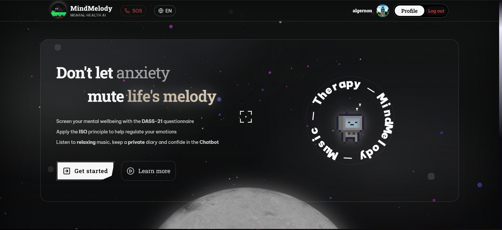
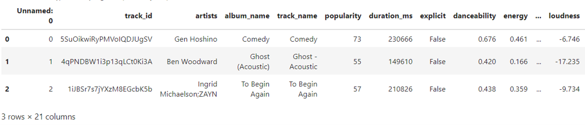
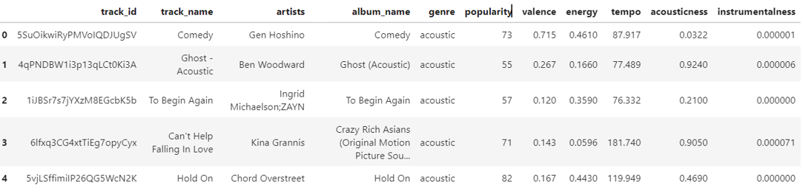

<div align="center">
  
  # MindMelody
  **Personalized Music Therapy System**

  <p>
    An automated psychological counseling system that guides emotions through music, <br>
    built on a weighted Euclidean distance algorithm combined with the ISO principle in music therapy and Large Language Models (LLMs).
  </p>

  [Live Demo](https://music-therapy-project.vercel.app/)

</div>

---

## Table of Contents
- [Home page](#home-page)
- [Features](#features)
- [Tech Stack](#tech-stack)
- [Quick Start](#quick-start)
- [Data](#data)


## Home page

<p align="center">

  

  
</p>
<p align="center">
  <i>i'll update Gif how to use when i have time xD</i>
</p>

---

## Features


- **Structured Psychological Data:** Integrates the clinical DASS-21 scale and quantifies Stress, Anxiety and Depression into a spatial vector.
- **Weighted Euclidean Algorithm:** Automatically calculates and steers the biorhythm (Tempo, Energy, Valence + Instrumentalness) based on the ISO music therapy principle.
- **Safety Gatekeeper & RAG:** Automatically detects self-harm intent (SOS Trigger) and blocks Prompt Injection attacks through Gemini 3.0.
- **Implicit Feedback:** The system learns on its own and updates personalization weights from listening behavior (Skip/Listen) and semantic analysis of chat messages.
- **Bilingual Interface:** Switch between English and Vietnamese at any time; the AI chatbot replies in the selected language.

## Tech Stack

| Layer | Technologies |
| --- | --- |
| **Frontend** | ReactJS (Vite), TailwindCSS, TanStack Query |
| **Backend** | Python, Django REST Framework |
| **Database** | PostgreSQL (Supabase Cloud) |
| **AI Engine** | Google Gemini API, YouTube oEmbed API |
| **Deployment** | Vercel (Client), Render (API Server) |

## Quick Start

<details>
<summary><b>1. Run the Backend (Django)</b></summary>
<br>

Move into the `backend` folder and set up the environment:

```bash
cd backend
python -m venv venv
source venv/bin/activate  # Or: venv\Scripts\activate on Windows
pip install -r requirements.txt
cp .env.example .env
```

Configure the `.env` file with your API keys (Supabase, Gemini, Google OAuth), then start the server:

```bash
python manage.py runserver
```
</details>

<details>
<summary><b>2. Run the Frontend (React)</b></summary>
<br>

Open a new terminal and move into `frontend`:

```bash
cd frontend
npm install
cp .env.example .env
```

Point `VITE_API_URL` to localhost in the `.env` file and run:

```bash
npm run dev
```
</details>

## Data

The data comes from Kaggle: 🎹 Spotify Tracks Dataset by MaharshiPandya - "A dataset of Spotify songs with different genres and their audio features". 
It contains over 115,000 tracks, over 125 music genres and 21 data fields.

<p align="center">

  

</p>

In this project, 10 fields that don't serve its purpose were filtered out. Final data:

<p align="center">

  

</p>

---
<div align="center">
  <p><i>- algernon -</i></p>
</div>